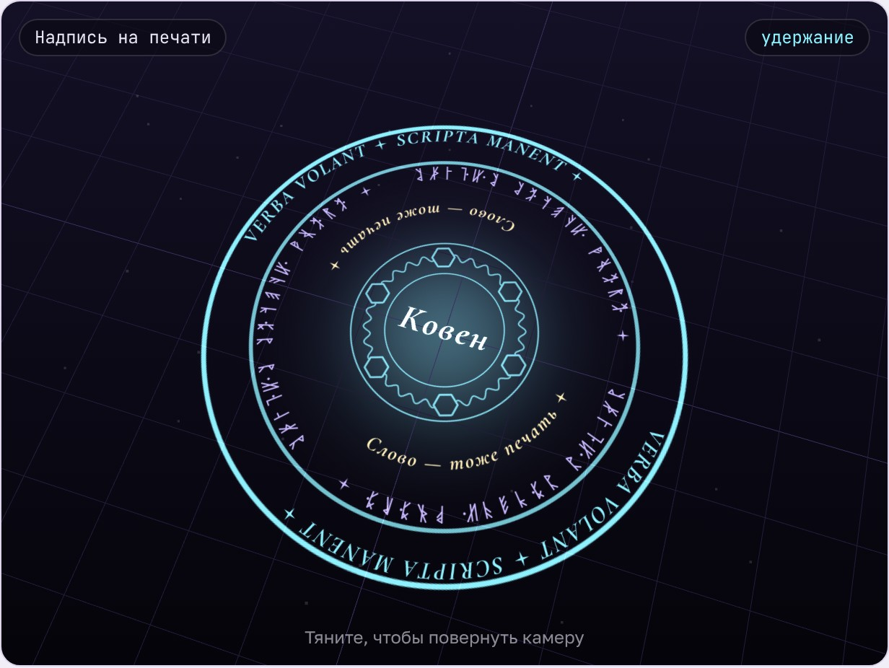
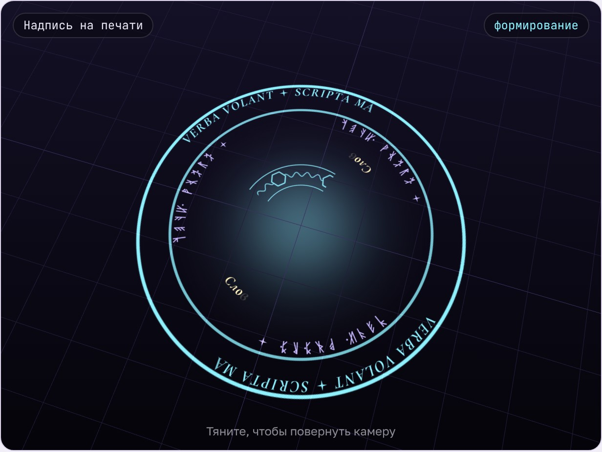
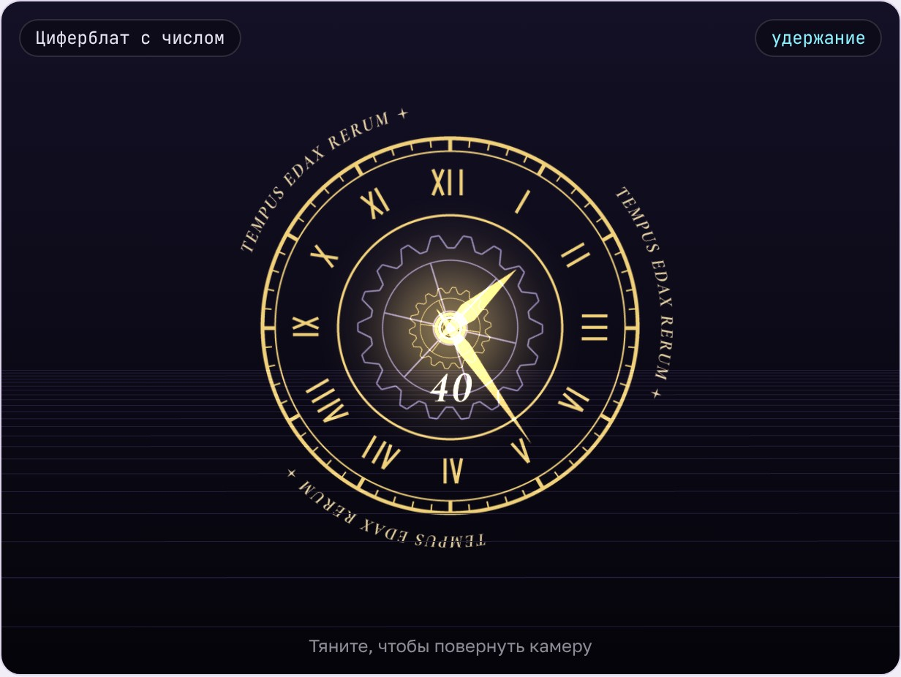
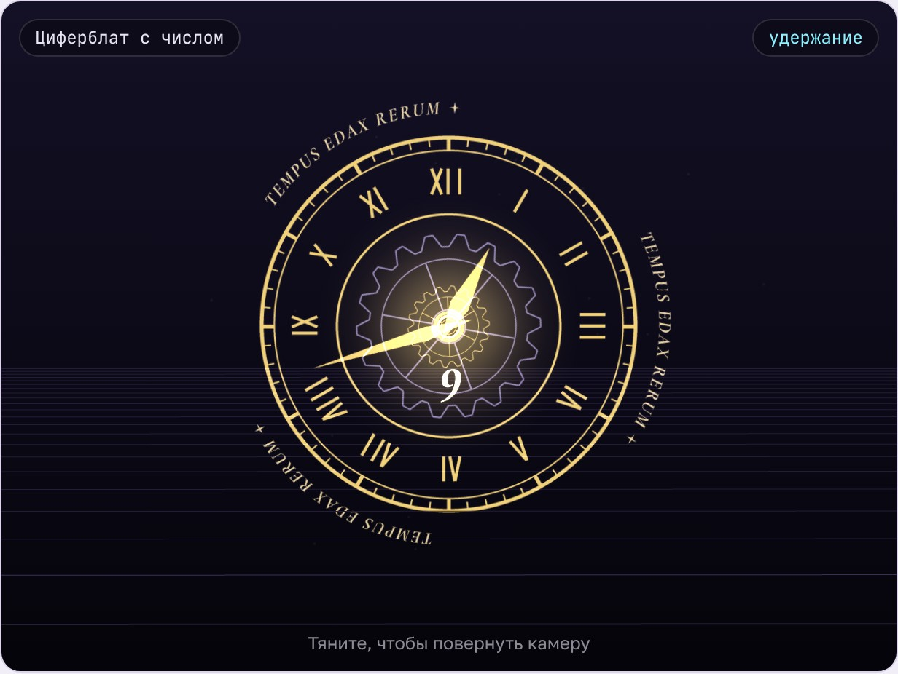
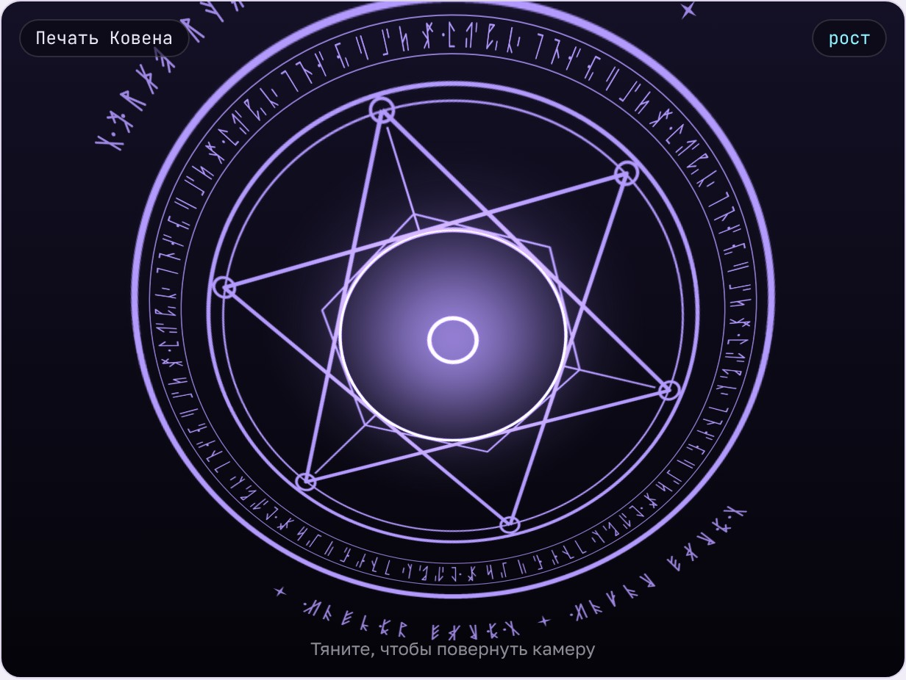
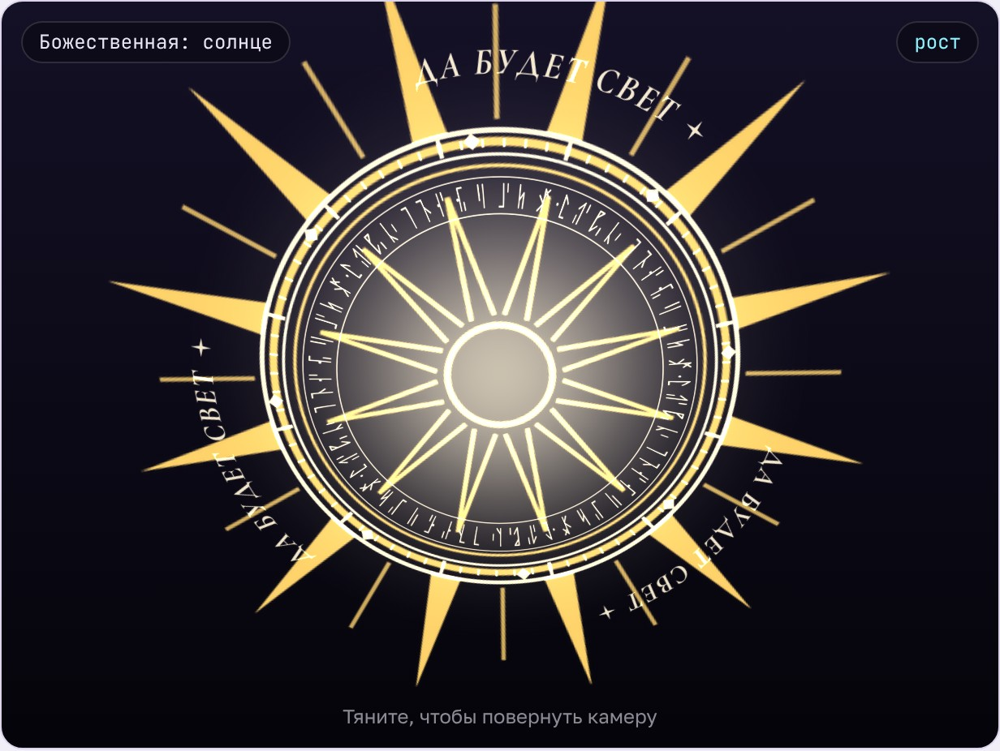

# T07 «Подписи-тексты на печатях» — готово (помощник управляющего)

**От кого:** сессия-помощник управляющего, задача T07 (+ цифра-счётчик для T04).
**Кому:** управляющему; часть «для чата Кодинга» — ниже, раздел «Что осталось».

## Коротко

Новый тип слоя печати `text`: надпись по окружности или прямой строкой, тремя шрифтами (`runic`, `latin`, `cyrillic`),
появляется режимом `draw` **буква за буквой** (каждая буква наплывает чуть крупнее и вспыхивает, когда «дописана»).
Текст подставляется при запуске (`Core.sigil(…, '{"text":"…"}')`) и меняется на живой печати (`Core.sigilText(…)`, `Fx.text(…)`) —
новая надпись вписывается заново со вспышкой. На этом сделан счётчик в «Обратном отсчёте».
Отрисовку в игре и подстановку текста при запуске/обновлении сделал сам (было несложно): всё по одной раскладке с превью.

| | |
|---|---|
|  |  |
| «Надпись на печати» (`text_demo`): латиница по ободу, руны, кириллица снизу, «Ковен» подставлен в центр | то же в момент появления: буквы пишутся по одной, руны — с конца |
|  |  |
| «Циферблат с числом» (`time_clock`): «TEMPUS EDAX RERUM ✦» ×3, счётчик 40 | в момент удара: новое число вписывается со вспышкой |
|  |  |
| `coven_seal`: снаружи рунами «Ковен видит ✦ Ковен помнит ✦» | `divine_sun`: «ДА БУДЕТ СВЕТ ✦» между нимбом и лучами |

Все кадры — Playwright по `tools/sigil_preview.html` (three.js r128 с cdnjs загрузился).

## Что сделано

1. **Атлас символов** — `tools/gen_sigil_glyphs.py` → `textures/sigil/glyphs_{runic,latin,cyrillic}.png` (сетка 16 × N ячеек по 128 px,
   рисуется ×4 и уменьшается) + карты `glyphs_*.json` (символ → [ячейка, ширина], базовая линия, высота прописных, пробел, `upper`,
   `fallback`). Лист-образец: `docs/media/sigil_glyphs.png`.
   - **Руны** — свои, в стиле печатей мода (штрихи со скруглёнными концами по сетке 3×4, вертикальная основа, как `rune_band`).
     Одна руна на звук: латиница и кириллица пишутся одними рунами (А = A, В = V, Х = H, Ц = C…), свои руны у Ж Ч Ш Щ Ъ Ь Э Ю Я и Q W X.
     Цифры — монастырские (цистерцианские) знаки. Алфавит задаётся одним зерном в генераторе.
   - **Латиница и кириллица** — каллиграфичная антиква с засечками Cormorant Garamond Bold Italic (шрифт под OFL, файлы и лицензия —
     в `tools/fonts/`, чтобы генератор работал без сети). Цифры прописные и одной ширины — счётчик не «пляшет». Кириллица берёт
     недостающее (латиницу, @, # …) из `latin` через `fallback`.
   - У всех трёх — украшения-разделители `· • ✦ ✧ ◆ ◇ ☉ ☽ ★ ❖`.
2. **Чистая логика** без Minecraft — `fx/sigil/SigilText.java`: разбор атласа (`Font`), поиск символа с запасными шрифтами (`resolve`),
   раскладка (`layout`: позиция и угол каждой буквы по окружности, `spacing`, `repeat` / `repeat 0` = сколько влезет, `align`, `angle`,
   `side` outer/inner/line, `fit` — ужать, если не влезает), «буква за буквой» (`reveal`), замена текста (`changeProgress`, `changeFlash`,
   `textFor`). В `SigilTimeline` — `letter(def, слой, буква, count, t, sinceChange)`. `SigilDef`: тип `TEXT`, у слоя поле `text()`.
   **Тест** `SigilTextTest` — 21 тест: атласы, руны «одна на звук», запасной шрифт, outer/inner/line, шаг по дуге, align, repeat, fill, fit,
   пробелы и неизвестные символы, табличные цифры, буква за буквой, замена текста, слоты, надписи в демо-печатях, **неизменное время
   формирования** `time_clock` / `coven_seal`.
3. **Формат** — `docs/sigils.md`, раздел «Надписи (`text`)»: поля с умолчаниями, формулы раскладки и появления, подстановка и замена,
   формат атласа. Коротко — в `docs/MOD_README.md` (Core.sigil / Core.sigilText).
4. **Превью** — слой `text` в `tools/sigil_preview.template.html` (те же формулы на JS; проверил: координаты последней буквы каждой надписи
   у Java и JS совпадают до 6 знаков), сцены «Надпись на печати» и «Циферблат с числом» (удары по таймлайну меняют число), в редакторе —
   тип `text` с полями текст/шрифт/сторона/кегль/разрядка/копии. `build_sigil_preview.py` вшивает карты атласов. Пересобрано.
   **Исправил заодно:** ориентация `facing` в превью была зеркальной относительно игры (у мода `u` — вправо от кастера); теперь как в игре,
   поэтому римские цифры циферблата и надписи читаются правильно со стороны кастера.
5. **Надписи в печатях:** `time_clock` (по ободу «TEMPUS EDAX RERUM ✦» ×3 — «время, пожиратель всего», Овидий; счётчик `count` в нижней
   части циферблата), `coven_seal` (рунами снаружи), `divine_sun` (кириллицей). Новые слои укладываются в старое время появления — `formedAt`
   этих печатей не изменился (это проверяет тест). Новая демо-печать `text_demo`.
6. **Код в игре (сделал сам):**
   - `client/fx/SigilDraw.text` — квадрат на букву из атласа, по раскладке `SigilText`, вращение/наклон/рост/разборка как у слоя,
     одна партия на атлас; кеш раскладки в `SigilRun` (пересчёт только при смене текста).
   - `FxLib.font(name)` — карта атласа из jar.
   - Сеть: `FxMsg` несёт тексты в START (поздно подошедшие видят последнюю надпись) и новую операцию `TEXT` (= 5; 4 занял `HIT` из T08);
     **`Net` версия → 9** (T08 уже поднял до 8 параллельно — при слиянии свёл в 9).
   - С T08/T09 (пришли параллельно, слил): надписи не светятся волной удара и не режутся на осколки при разборке `cracks` —
     гаснут вместе с печатью (и в игре, и в превью).
   - Сервер: `Fx.Spec.text(slot, text)`, `Fx.text(sl, inst, slot, text)` (тот же текст повторно не шлётся); `Api`: опции `"text"` / `"texts"`
     у `Core.sigil`, новый `Core.sigilText(level, id, slot, text)`.
   - **T04 «Обратный отсчёт»:** циферблат стартует с `"0"`, на каждом ударе по цели число обновляется. **Решение:** показывается урон,
     который вернётся (сумма × `damageMult`, с потолком `maxRepeat`), а не число ударов — игроку видно, «сколько прилетит». Ниже 10 — с одной
     десятой («4.5»). Если владелец захочет число ударов — одна строка в `CountdownSpell` (`counter(c.hits)`).

## Проверка

- `./gradlew test` **не прошёл в этом окружении**: Gradle падает на зависимости Iron's Spellbooks (`Could not resolve … irons_spellbooks-1.20.1:3.16.1`),
  как и у прошлых сессий — Forge-сборка только на ПК.
- Чистую логику проверил отдельно: `javac` пакета `fx/sigil` + JUnit 5 (console standalone) — после слияния с T08/T09 **57/57 тестов**
  (`SigilTextTest` 21, `SigilTimelineTest`, `SigilLightTest`, `SigilHitTest`, `SigilCracksTest`).
- Код, зависящий от Minecraft (`SigilDraw`, `FxClient`, `SigilRun`, `FxMsg`, `Fx`, `Api`, `CountdownSpell`), **не компилировался** — нет Forge.
  Перечитал вручную; ошибки компиляции маловероятны, но возможны.

## Что осталось (для чата Кодинга)

1. Собрать на ПК (`gradlew build`), прогнать `gradlew test`.
2. В игре: `/pohsmp sigil play text_demo` — надписи пишутся буква за буквой, читаются; руны идут с конца.
   Из скрипта CNPC: `Core.sigil(level, "text_demo", x, y, z, '{"text":"Ковен"}')` — в центре «Ковен»; затем
   `Core.sigilText(level, id, "text", "Кайто")` — имя вписывается заново со вспышкой.
3. «Обратный отсчёт»: над целью циферблат, внизу «0»; ударить цель несколько раз — число растёт со вспышкой; проверить, что надписи
   **не зеркальные** со стороны кастера (ориентация `facing`) и что видно у второго игрока, подошедшего позже (последнее число).
4. `/pohsmp sigil play coven_seal`, `divine_sun` (снизу) — надписи читаются, не зеркальные.
5. Версия мода — на ваше усмотрение (поменялся сетевой протокол, `Net` = 9: клиент и сервер нужны одной сборки).
6. Необязательно: `/pohsmp sigil play` без подстановки текста — если нужно, добавить аргумент.
