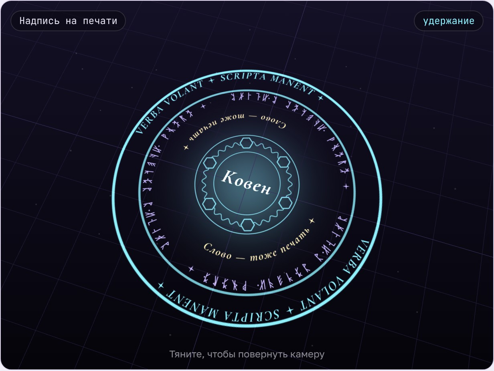
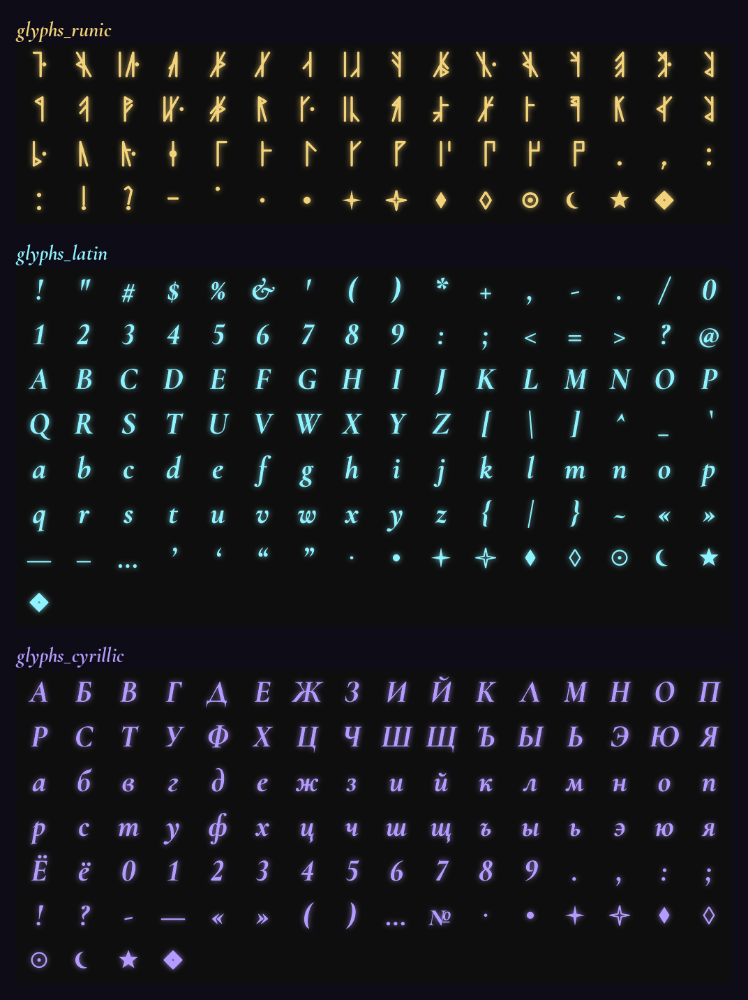

# Печати: формат JSON

Черновик схемы для системы печатей из [`specs/sigils_spec.md`](specs/sigils_spec.md). Схема проверена 3D-превью
`tools/sigil_preview.html`: оно читает эти же файлы и считает тайминги так, как должен считать мод.
При расхождении с заданием верным считается это описание: оно уточняет задание.

- Файлы печатей: `assets/pohsmp_core/sigils/<id>.json`.
- Текстуры: `assets/pohsmp_core/textures/sigil/<name>.png`, белое на прозрачном (цвет задаётся в JSON).
  Генератор — `tools/gen_sigil_textures.py`.
- Время везде в **тиках** (20 в секунду), углы в **градусах**, размеры в **блоках**.

## Печать

```json
{
  "size": 3.0,
  "color": "#8FF3FF",
  "orientation": "sky",
  "lifetime": -1,
  "hold": 120,
  "layers": [ … ],
  "expand": { "scale": 4.0, "delay": 4, "duration": 20, "easing": "easeOutCubic" },
  "formedFlash": { "color": "#FFFFFF", "size": 1.25, "duration": 12, "sparks": 40 },
  "onFormed": [ … ],
  "dissolve": { "modes": ["reverse", "collapse"], "duration": 20, "stagger": 3 }
}
```

| Поле | Что это |
|---|---|
| `size` | радиус печати в блоках. Радиусы слоёв — доли от него |
| `color` | цвет по умолчанию для всех слоёв (`#RRGGBB`) |
| `orientation` | `ground` — лежит на земле лицом вверх; `sky` — висит лицом вниз; `facing` — вертикально, смотрит туда же, куда кастер; `billboard` — всегда к камере; `outward` — неподвижно лежит на сфере вокруг якоря элемента (нормаль от якоря к печати, напр. печати на куполе; для эффектов с `at: "caster+x,y,z"`) |
| `lifetime` | сколько тиков живёт печать всего; `-1` — пока её не остановят |
| `hold` | сколько тиков держать после формирования, потом разборка; `-1` — держать, пока не остановят |
| `layers` | слои, см. ниже. Порядок важен: разборка `reverse` гасит их с конца |
| `expand` | рост всей печати после появления слоёв: множитель `scale`, задержка, длительность, плавность |
| `formedFlash` | вспышка в момент формирования: кольцо-волна до `size` (доля размера печати), свечение, `sparks` искр |
| `onFormed` | дочерние печати, которые появляются в момент формирования |
| `dissolve` | разборка: режимы `modes`, длительность, `stagger` — шаг между слоями для `reverse` |
| `groundLight` | пятно света её цвета на ближайшей поверхности под печатью, см. «Свет на земле». Нет поля — выключено |
| `blockGlow` | подкраска верхних граней блоков вокруг печати, к краю тускнеет, см. «Свет на земле». Нет поля — выключено |

## Тайминги (как считать «сформирована»)

```
layersEnd   = max по слоям (appear.delay + appear.duration)
expandStart = layersEnd + expand.delay            (если expand нет — layersEnd)
formedAt    = expandStart + expand.duration        (если expand нет — layersEnd)
```

В `formedAt`: вспышка, дочерние печати, серверный колбэк «печать сформирована» (заклинание может бить ровно после формирования).
Разборка начинается в `formedAt + hold` или по команде.

## Слой

```json
{ "id": "runes", "type": "band", "texture": "rune_band", "radius": 0.86, "inner": 0.86, "repeat": 6,
  "heightOffset": 0.03, "color": "#…", "brightness": 1.0,
  "appear": { "delay": 34, "duration": 10, "easing": "easeInOutSine", "modes": ["draw"], "startAngle": 90, "direction": 1 },
  "rotation": { "speed": 12, "boost": 2.0 },
  "pulse": { "amp": 0.2, "period": 30 } }
```

| Поле | Что это |
|---|---|
| `type` | `disc` — квадрат с текстурой (круг); `band` — кольцевая лента, текстура повторяется по окружности `repeat` раз, от `inner`·r до r; `arcs` — `count` разорванных дуг длиной `arcLength`° и толщиной `width` (доля радиуса); `spokes` — как `disc`, для текстур с лучами; `text` — надпись по окружности или строкой (раздел «Надписи») |
| `texture` | имя текстуры без `.png` |
| `radius` | радиус слоя, доля `size` |
| `heightOffset` | смещение вдоль нормали в блоках, чтобы слои не мерцали друг в друге (по 0.01 на слой) |
| `color`, `brightness` | свой цвет слоя и множитель яркости (по умолчанию цвет печати и 1) |
| `appear.delay`, `duration`, `easing` | когда и как долго слой появляется, плавность |
| `appear.modes` | можно сочетать: `grow` — масштаб 0→1; `fade` — прозрачность 0→1; `draw` — прорисовка по углу 0→360° от `startAngle` (`direction` 1 или −1); `twist` — доворот на `appear.twist`° к нулю; `unfold` — разворот из «ребром к камере» в плоскость; `assemble` — только для `arcs`: дуги стартуют дальше от центра, с разных углов, и смыкаются в кольцо; `pieces` — сборка по частям (раздел ниже) |
| `rotation.speed` | вращение, °/с (знак — направление); `boost` — во столько раз быстрее, пока слой появляется (плавно затухает к концу появления) |
| `pulse` | пульсация яркости: амплитуда (доля) и период в тиках |

### Как считать слой в момент `t` (тики от старта печати)

```
p     = clamp((t - delay) / duration, 0, 1);   e = easing(p)
scale = grow ? e : 1
alpha = fade ? e : (t >= delay ? 1 : 0)
angle = ∫ speed * (1 + boost * (1 - e)) dt  + (twist ? appear.twist * (1 - e) : 0)
tilt  = unfold ? 90° * (1 - e) : 0                    (поворот вокруг оси X плоскости)
draw  = 360° * e                                       (рисуется сектор/лента до этого угла)
arcs (assemble): радиус ×(1 + 0.9·(1 - e)), длина дуги = arcLength + (360/count − arcLength)·e,
                 сдвиг каждой дуги ±150°·(1 − e) (чётные в одну сторону, нечётные в другую)
pulse: alpha *= 1 + amp * sin(2π t / period)
печать целиком: scale *= 1 + (expand.scale − 1) · easing((t − expandStart) / expand.duration)
```

## Надписи (`text`)

Строка букв по окружности слоя или прямой строкой через центр. Буквы берутся из атласа символов, каждая — отдельный квадратик,
поэтому надпись вращается, пульсирует, растёт и разбирается как любой слой, а `draw` пишет её **буква за буквой**.
Текст можно подставить при запуске и заменить, пока печать жива (счётчик на циферблате «Обратного отсчёта»).
Пример со всеми возможностями — `text_demo` (превью: «Надпись на печати»), счётчик — `time_clock` (превью: «Циферблат с числом»).



```json
{ "id": "motto", "type": "text", "text": "TEMPUS EDAX RERUM ✦", "font": "latin", "radius": 1.1, "size": 0.13,
  "spacing": 0.08, "repeat": 3, "side": "outer", "align": "center", "heightOffset": 0.05, "color": "#FFE9B0", "brightness": 0.9,
  "appear": { "delay": 14, "duration": 20, "easing": "easeInOutSine", "modes": ["draw"] }, "rotation": { "speed": 4, "boost": 3 } },
{ "id": "count", "type": "text", "text": "", "slot": "count", "font": "latin", "side": "line", "radius": -0.3, "size": 0.32,
  "change": 6, "changeFlash": 1.2, "appear": { "delay": 22, "duration": 10, "modes": ["fade"] } }
```

| Поле | По умолчанию | Что это |
|---|---|---|
| `text` | `""` | строка. Пробел — промежуток шириной `space` шрифта; символа нет в шрифте — тоже промежуток (не рисуется) |
| `font` | `latin` | `runic` — руны мода, `latin` — каллиграфичная латиница, `cyrillic` — кириллица (чего в ней нет — берётся из `latin`) |
| `radius` | 1 | окружность, по которой идёт **середина прописных букв** (доля `size` печати). Для `side: "line"` — сдвиг строки от центра по вертикали плоскости (−0.3 — ниже центра) |
| `size` | 0.12 | кегль: высота ячейки буквы (доля `size` печати). Прописные ≈ 0.44 кегля |
| `spacing` | 0.06 | добавка между буквами, доля кегля (разрядка; может быть отрицательной) |
| `repeat` | 1 | сколько копий по кругу, равномерно (копия k сдвинута на k·360/repeat°). `0` — столько, сколько влезет (с промежутком в пробел) |
| `side` | `outer` | `outer` — буквы стоят на окружности головой наружу и читаются по часовой (верх монеты); `inner` — головой к центру, против часовой (низ монеты); `line` — прямая строка |
| `align` | `center` | какая точка текста стоит на `angle`: `center`, `start` (начало), `end` (конец) |
| `angle` | 90 / 270 / 0 | угол привязки, ° (90 — верх). По умолчанию: `outer` — 90, `inner` — 270, `line` — 0 (для строки это наклон самой строки) |
| `fit` | `true` | если копия не помещается в свою долю круга (×0.97), буквы уменьшаются, чтобы влезла |
| `slot` | нет | имя, под которым текст подменяется при запуске и потом (см. ниже). Нет `slot` — надпись постоянная |
| `change` | 6 | за сколько тиков новая надпись вписывается буква за буквой после замены |
| `changeFlash` | 0.8 | вспышка всего слоя в момент замены: яркость × (1 + changeFlash·(1 − p)²) |
| `color`, `brightness`, `heightOffset`, `rotation`, `pulse`, `appear` | | как у любого слоя. `rotation` вращает всю надпись вокруг центра |

**Режимы появления.** `draw` — буквы пишутся по одной в порядке чтения (`appear.direction: -1` — с последней), копии — одновременно;
`fade`, `grow` (рост всей надписи из центра), `twist`, `unfold` — как у остальных слоёв. Без `draw` все буквы появляются сразу.

### Раскладка (как считать)

```
advance_i  = ширина буквы из атласа · size;   L = Σ advance_i + spacing·size·(n − 1)       (n — символов, вместе с пробелами)
копии      = repeat, или (repeat 0) ⌊2π·r / (L + (space + spacing)·size)⌋
fit        : если L / r > 0.97 · 2π / копии — size уменьшается до 0.97·2π·r / (копии · L/size)
pos_i      = начало буквы + advance_i / 2;   anchor = L/2 (center) | 0 (start) | L (end)
окружность : θ_i = angle + dir·k·360/копии + dir·(pos_i − anchor)/r  (рад → °);  dir = −1 для outer (по часовой), +1 для inner
             «верх» буквы: θ_i (outer) или θ_i + 180° (inner); центр ячейки на радиусе r ∓ drop
строка     : центр ячейки = (pos_i − anchor) вдоль угла angle, сдвиг radius − drop поперёк;  «верх» — angle + 90°
drop       = (0.5 − (baseline − capHeight/2)) · size     (центр ячейки чуть ниже середины прописных)
```

Буква — квадрат со стороной `size`, центр в точке выше, поворот — по «верху». Слою `text` масштаб из `SigilTimeline.layer`
приходит **без** умножения на радиус (только `grow`): радиус уже учтён в раскладке.

### Буква за буквой

```
p = easing((t − delay) / duration)              (для draw; после замены текста p = (t − изменён) / change)
k = номер буквы в порядке чтения (с конца при direction −1), count — букв в копии (без пробелов)
x = p · (count + 1.5) − k
alpha      = clamp01(x / 1.5)                    (мягкий «фронт пера» шириной в полторы буквы)
scale      = 1 + 0.35 · (1 − alpha)              (буква наплывает чуть крупнее и садится на место)
brightness = 1 + 0.9 · 4·alpha·(1 − alpha)       (вспыхивает в момент написания)
```

Первая буква начинает сразу при p = 0, последняя дописана ровно к p = 1. После замены текста обе прогрессии перемножаются,
яркость умножается ещё на вспышку замены.

### Подстановка и замена текста

- Слои со `slot` показывают подставленный текст, если он есть, иначе свой `text`.
- При запуске из скриптов CNPC: `Core.sigil(level, "text_demo", x, y, z, '{"text":"Ковен"}')` — заполняет слот `text`;
  `'{"texts":{"count":"0","name":"Ковен"}}'` — любые слоты.
- Пока печать жива: `Core.sigilText(level, id, "count", "12")`. Новая надпись вписывается за `change` тиков со вспышкой.
  Тот же текст повторно — ничего не отправляется. Игроки, подошедшие позже, видят последнюю надпись.
- Из Java: `Fx.sigil("time_clock")….text("count", "0")` при запуске, `Fx.text(sl, inst, "count", "12")` потом.
- Длина надписи — до 256 символов. Дочерние печати получают тексты родителя.

### Атласы символов

`textures/sigil/glyphs_<font>.png` + карта `glyphs_<font>.json`, генератор — `tools/gen_sigil_glyphs.py`
(шрифт для латиницы и кириллицы — Cormorant Garamond Bold Italic, OFL, лежит в `tools/fonts/`). Лист-образец — `docs/media/sigil_glyphs.png`.



```json
{ "font": "latin", "texture": "glyphs_latin", "cell": 128, "cols": 16, "rows": 8, "baseline": 0.7, "capHeight": 0.44,
  "space": 0.163, "upper": false, "fallback": null, "glyphs": { "A": [33, 0.384], … } }
```

| Поле | Что это |
|---|---|
| `cell`, `cols`, `rows` | ячейка в пикселях и сетка; ячейка k — столбец k % cols, строка k / cols (uv = ячейка / сетка) |
| `baseline`, `capHeight` | базовая линия и высота прописных — доли ячейки сверху |
| `space` | ширина пробела, доля ячейки |
| `upper` | искать символы в верхнем регистре (руны: строчные = прописные) |
| `fallback` | шрифт, где искать отсутствующие символы (`cyrillic` → `latin`) |
| `glyphs` | символ → [номер ячейки, ширина (advance) в долях ячейки]. Несколько символов могут указывать на одну ячейку |

- **runic** — свои руны в стиле печатей: прямые штрихи со скруглёнными концами по сетке узлов 3×4, вертикальная основа, как
  в `rune_band`. Одна руна на звук: латиница и кириллица пишутся одними рунами (А = A, Б = B, В = V, Г = G, … Х = H, Ц = C, Ы = Y),
  свои руны у Ж Ч Ш Щ Ъ Ь Э Ю Я и Q W X. Цифры — монастырские (цистерцианские) знаки: основа с меткой в углу, 0 — основа с кольцом.
- **latin** — ASCII, « » — – … ’ ‘ “ ”; цифры прописные и одной ширины (счётчик не «пляшет»).
- **cyrillic** — А–я, Ё ё, цифры, основные знаки, №.
- У всех трёх — украшения-разделители: `·` `•` `✦` `✧` `◆` `◇` `☉` `☽` `★` `❖`.

Добавить символ: дописать его в списки `tools/gen_sigil_glyphs.py` и запустить генератор — номера ячеек пересчитаются, печати
трогать не нужно.

В Java: `SigilText` (пакет `fx.sigil`) — `Font.parse`, `resolve`, `layout`, `reveal`; `SigilTimeline.letter` — состояние буквы в момент `t`;
клиент — `FxLib.font(name)` и `SigilDraw.text`. Тест — `SigilTextTest`.

## Сборка по частям (`pieces`)

Как печать, из которой выходит портал в Silent Gate. Слой (`disc` или `band`) режется на `count` равных секторов. Части прилетают
по одной, на подлёте кувыркаются и встают на место со вспышкой-«щелчком». Пример — `silent_gate_pieces` (превью: «Сборка по частям (пример)»).
Разборка у такой печати обычная (`reverse` + `collapse` — гаснет слоями и сжимается в точку), части не разлетаются.

```json
"appear": { "delay": 70, "duration": 36, "easing": "easeOutBack", "modes": ["pieces"],
  "pieces": { "count": 16, "order": "scatter", "pieceTime": 0.35, "fly": 0.35, "lift": 0.3, "orbit": 25, "tilt": 90, "spin": 50, "lockFlash": 0.8 } }
```

| Поле | Что это (по умолчанию) |
|---|---|
| `count` | число частей (8); часть k — сектор от k·360/count до (k+1)·360/count |
| `order` | порядок прилёта: `scatter` — вразброс по кругу (шаг — ближайшее к 0.382·count число, взаимно простое с count), `around` — по кругу, `alternate` — парами напротив друг друга (scatter) |
| `pieceTime` | доля `duration`, за которую летит одна часть; остальное — разнос стартов (0.45) |
| `fly` | насколько дальше от центра начинает (доля радиуса слоя, 0.9) |
| `lift` | насколько выше плоскости начинает (доля радиуса, 0.5) |
| `orbit` | доворот вокруг центра печати, градусы (40; чётные части в одну сторону, нечётные в другую) |
| `tilt` | кувырок вокруг касательной через центр части, градусы (75) |
| `spin` | поворот вокруг своей оси (нормали) через центр части, градусы (120) |
| `lockFlash` | добавка яркости в момент встановки, гаснет за 5 тиков (0.8) |

```
rank(k)  = порядковый номер прилёта (перестановка 0..count-1)
fly      = duration · pieceTime;   start(k) = delay + (duration − fly) · rank / (count − 1)
u        = easing((t − start) / fly)          (0 — далеко, 1 — на месте; easeOutBack даёт отскок при встановке)
alpha    = clamp(2.5·u);   w = 1 − u;   side = +1 для чётных k, −1 для нечётных
центр части: радиус centerRadius·(1 + fly·w) (centerRadius = 0.62 у disc, (inner+1)/2 у band), угол центра сектора + orbit·w·side,
             подъём lift·w по нормали
поворот части вокруг её центра: spin·w·side вокруг нормали, затем tilt·w·side вокруг касательной
яркость  = 1 + lockFlash · max(0, 1 − |t − (start + fly)| / 5)
```

Текстура у частей непрерывная: у `disc` координаты берутся по положению, у `band` — `u` от абсолютного угла.
В Java это `SigilTimeline.piece(def, слой, k, t, stopAt)` → `PieceState` и `pieceRank(order, k, n)`.

Плавности: `linear`, `easeInSine`, `easeOutSine`, `easeInOutSine`, `easeInCubic`, `easeOutCubic`, `easeInOutCubic`, `easeOutBack`.

## Разборка

`dissolve.modes` можно сочетать (`d` — доля от 0 до 1 за `duration`):

| Режим | Что делает |
|---|---|
| `reverse` | слои гаснут с последнего к первому, каждый следующий на `stagger` тиков позже |
| `collapse` | вся печать сжимается в точку: масштаб × (1 − easeInCubic(d)) |
| `fade` | вся печать гаснет: прозрачность × (1 − d) |
| `shatter` | слои разлетаются наружу: масштаб × (1 + 0.8·d), гаснут |

Остановка родителя останавливает и его дочерние печати.

## Свет на земле (`groundLight`, `blockGlow`)

```json
"groundLight": { "radius": 0.6, "strength": 0.55, "reach": 48 },
"blockGlow":   { "radius": 1.0, "strength": 0.3, "falloff": 1.5, "reach": 48 }
```

| Поле | По умолчанию | Что это |
|---|---|---|
| `groundLight.radius` | 0.8 | радиус пятна — доля **текущего** радиуса печати (растёт с `expand`, сжимается с `collapse`) |
| `groundLight.strength` | 0.6 | яркость пятна (аддитивно; больше 1 — пересвет) |
| `groundLight.reach` | 32 | на сколько блоков вниз от печати искать поверхность; дальше — пятна нет |
| `blockGlow.radius` | 1.1 | радиус подсветки блоков — доля текущего радиуса печати |
| `blockGlow.strength` | 0.35 | яркость в центре |
| `blockGlow.falloff` | 1.5 | спад к краю: яркость = `strength · (1 − d/radius)^falloff`; 1 — линейно, больше — ярче центр |
| `blockGlow.reach` | 32 | как у `groundLight` |

- `true` или `{}` — включить со значениями по умолчанию, `false` / нет поля — выключено.
- Работает при любой ориентации: точка отсчёта — первая поверхность в столбце под центром печати (для `ground` — та, на которой она лежит).
  Свет движется вместе с печатью (`follow`, `MOVE`).
- Сила по времени (`SigilTimeline.lightLevel`): растёт от 0 до 1, пока появляются слои (до `layersEnd`), гаснет за время разборки.
  Чем выше печать над поверхностью, тем слабее: при высоте `reach` — вдвое.
- Как сделано (без шейдеров): аддитивная декаль поверх верхних граней. Для каждого столбца блоков в радиусе берётся верхняя
  открытая грань (коллизия блока или поверхность жидкости, трава и цветы пропускаются) в пределах +4…−8 блоков от точки под
  центром; на неё кладётся квадрат на 0.015 выше грани. `groundLight` — текстура `glow`, растянутая на квадрат 2R, поэтому выглядит
  одним круглым пятном, которое ложится по рельефу; `blockGlow` — белая текстура с яркостью по углам каждой грани.
  Высоты кешируются на 10 тиков; радиус обрезается до 24 блоков. Световой уровень блоков не меняется (не трогает освещение мира
  и не пересчитывает чанки), поэтому мобы и рост растений от него не зависят.
- `[fx] quality = low` — оба флага не рисуются.
- Включено у `silent_gate_sky` и `disintegration_field`.
- Код: `client/fx/SigilLight.java`; разбор и профиль спада — `SigilDef.GroundLight` / `SigilDef.BlockGlow`, тест `SigilLightTest`.
  Превью `tools/sigil_preview.html` эти флаги пока не показывает.

## Дочерние печати

```json
"onFormed": [
  { "id": "golden_halo", "anchor": "caster",
    "arc": { "count": 6, "radius": 1.5, "angle": 150, "height": 1.55, "behind": true, "stagger": 3 } }
]
```

- `anchor`: `caster` — вокруг кастера, иначе — вокруг центра печати.
- `arc`: `count` штук на дуге радиусом `radius` блоков, раствор `angle`°, на высоте `height`; `behind` — дуга за спиной
  (иначе перед кастером); каждая следующая появляется на `stagger` тиков позже.
- Без `arc` дочерняя печать появляется в центре родителя.

## Демо-печати

| id | Что |
|---|---|
| `silent_gate_pieces` | пример сборки по частям: ядро (6 частей парами) → спирали (8 вразброс) → кольцо рун (12 по кругу) → обод (16 вразброс), щелчки-вспышки; разборка `reverse`+`collapse` |
| `silent_gate_sky` | небесная: 4 дуги смыкаются → свечение → ядро → спирали → кольцо рун прорисовывается → обод; рост ×4; разборка `reverse`+`collapse` |
| `silent_gate_ground` | земная под кастером: свечение, спирали и ядро с доворотом, руны прорисовываются пером, обод; после формирования — 6 золотых кругов дугой за спиной |
| `golden_halo` | маленький золотой круг, раскрывается разворотом из ребра; дочерний |
| `coven_seal` | печать Ковена: гексаграмма прорисовывается, руны в обратную сторону, рост ×2.5 (для «Появления Ковена» и «Закрытия Пространства») |
| `time_clock` | время: циферблат прорисовывается против часовой, шестерёнки, стрелки бешено бегут при появлении и замедляются (стрелки — обычные вращающиеся слои) |
| `stars_orbit` | звёзды: созвездия с доворотом, три дуги-орбиты смыкаются, кольцо рун |
| `divine_sun` | Божественная: солнце с нимбом в небе, мягкий рост ×1.6, золотые круги за спиной |
| `higher_blades` | Высшая: алые трещины с перелётом, быстрые клинки по ободу, разборка `shatter` |
| `forbidden_chains` | Запретная: разлом в центре, кольцо цепей прорисовывается, тяжёлая разборка |
| `text_demo` | пример надписей: латиница по ободу, руны (`repeat 0`), кириллица снизу (`inner`), имя в центре (`line`, слот `text`) |

Надписи (T07) есть у `time_clock` (по ободу «TEMPUS EDAX RERUM ✦» ×3, счётчик `count` в нижней части циферблата),
`coven_seal` (снаружи рунами «Ковен видит ✦ Ковен помнит ✦») и `divine_sun` (между нимбом и лучами «ДА БУДЕТ СВЕТ ✦» ×3).
Время формирования этих печатей не изменилось.

## Код (готово в чате идей)

Чистая логика без Minecraft — пакет `ru.pohsmp.core.fx.sigil`:

- `SigilDef` — определение печати и разбор JSON (`SigilDef.parse(id, json)`), только Gson.
- `SigilTimeline` — всё, что зависит от времени: `timings` (`formedAt`), `autoStopAt`, `globalScale`, `globalAlpha`,
  `layer(def, i, t, stopAt)` → альфа, масштаб, угол, наклон, доля прорисовки, параметры дуг; `finished`;
  `piece(def, i, k, t, stopAt)` → положение и поворот одной части слоя с режимом `pieces`; `letter(def, i, k, count, t, sinceChange)` →
  прозрачность, масштаб и яркость буквы надписи.
- `SigilText` — надписи: атлас (`Font`), раскладка букв по окружности/строке (`layout`), «буква за буквой» (`reveal`).
- `Easing` — плавности по именам из JSON.
- Тесты: `src/test/java/.../SigilTimelineTest.java`, `SigilLightTest.java`, `SigilTextTest.java` (`gradlew test`), проверяют демо-печати и формулы этого документа.

Отрисовщику в игре остаётся только рисовать то, что возвращает `SigilTimeline`, а серверу — брать `timings().formedAt()`
для колбэка «печать сформирована».

## Как добавить новую печать

1. Если нужна новая текстура — добавить функцию в `tools/gen_sigil_textures.py` и запустить его. Новые символы надписей —
   `tools/gen_sigil_glyphs.py`.
2. Создать `assets/pohsmp_core/sigils/<id>.json` по этой схеме (проще всего скопировать похожую демо-печать).
3. Запустить `python3 tools/build_sigil_preview.py` и посмотреть печать в `tools/sigil_preview.html`
   (добавить сцену в `SCENES` шаблона, если нужна своя).
4. В игре: `/pohsmp sigil reload`, затем `/pohsmp sigil play <id>`.
